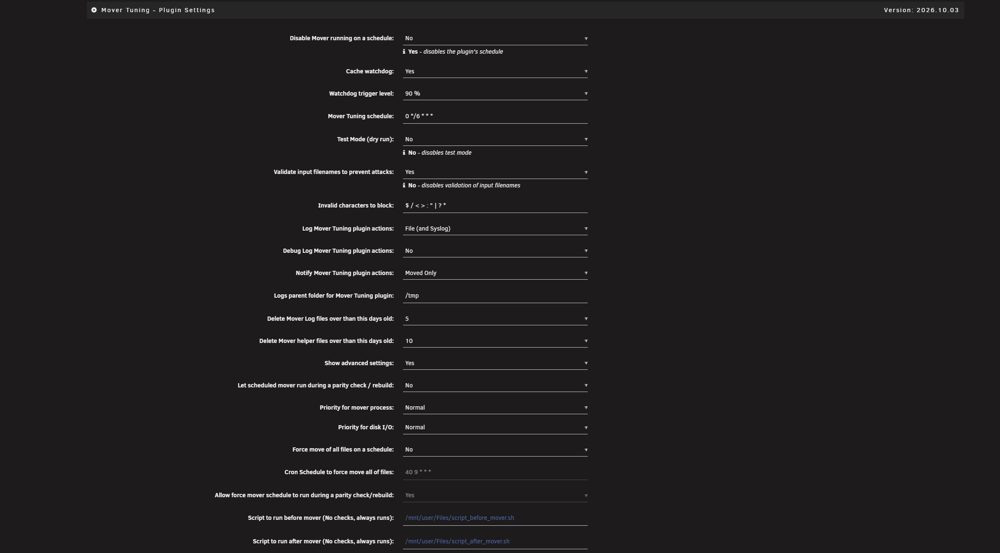
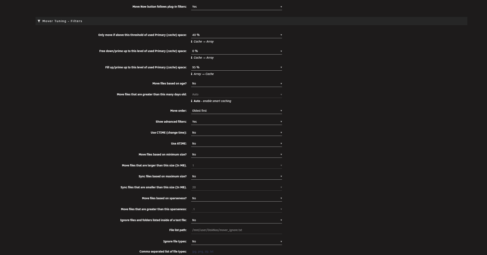
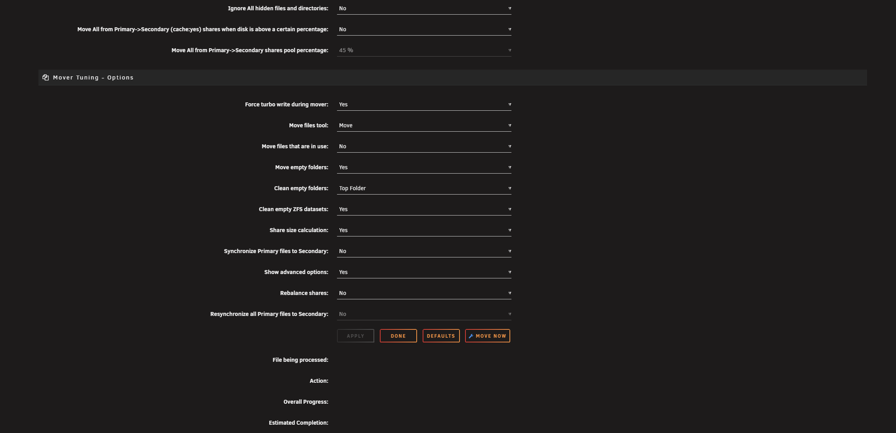
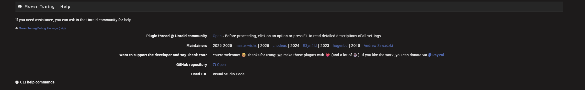

# Mover Tuning

## About

This is an [Unraid](https://unraid.net/) plugin that lets you fine-tune the operation of the [mover](https://docs.unraid.net/unraid-os/using-unraid-to/manage-storage/cache-pools/#using-mover).

This fork merges all [pull requests](https://github.com/R3yn4ld/ca.mover.tuning/pulls) from [R3yn4ld](https://github.com/R3yn4ld/ca.mover.tuning) after review (cosmetics, per-share skipfiletypes merge, automatic age threshold, filename sanitizing, Unraid 7.x compatibility) and adds many new features. See [CHANGELOG.md](CHANGELOG.md) for the full history.

**Requires Unraid 6.9.0-rc2 or newer.** Unraid 7.2.1+ and the 7.4 rc1 are supported (see [Unraid 7.2.1 and newer](#unraid-721-and-newer)).

> **Tip:** click on any option or press **F1** on the settings page to read a detailed description of all settings.

## Features

**When and what to move**

- Only move files if the cache is getting full: *move above* a threshold of used Primary (cache) space, *free down* to a lower level, and *fill up* (Array → Cache) to a chosen level.
- Filter by file age ("Auto" enables smart caching), CTIME or ATIME, minimum size, sparseness, hidden files, file types, or a list of ignored files and folders in a text file.
- **Move order:** oldest, largest or smallest first.
- Optionally move all files from Primary → Secondary (cache:yes) shares when the pool is above a chosen percentage.
- **Cache watchdog** (opt-in): monitors the cache and starts a run when the pool reaches a trigger level.
- Optionally don't run the scheduled mover during a parity check / rebuild.
- Optionally force a move of all files on a schedule, or disable the scheduled run completely.
- Files that are in use are left where they are, unless you enable "Move files that are in use".
- Choose the file-moving tool: Move (Unraid's built-in utility) or Rsync. Optionally force turbo write and set the priority of the mover process and of disk I/O.

**Shares**

- Per-share overrides of the global settings (Shares → click a share → Mover Tuning). Every override has a "Use global" choice.
- Cache:prefer shares: array → cache moves up to a configurable fill-up level.
- Rebalance, Resynchronize and Synchronize Primary files to Secondary (with an optional maximum file size). "Run once" options reset themselves after the run.
- Moving between pools (Unraid 7+).
- Ignore list and ignored file types (with wildcard support) also work for cache:prefer shares and `/mnt/user` paths.
- Hardlinked files are moved and synced together.
- "Share size calculation" option to avoid slow scans on large or busy shares.

**Cleanup**

- Optional moving and cleanup of empty folders, including top-level share folders.
- Cleanup of empty ZFS datasets, with protection for ZFS datasets and `.placeholder` files.

**Safety, logging and troubleshooting**

- Test Mode (dry run) with clear warnings.
- Optional filename validation with a configurable list of blocked characters.
- Live progress of a run (file being processed, action, overall progress, estimated completion).
- Detailed logs (file only, or file and syslog), configurable log folder and log age, and a "Run by" entry showing whether the run came from cron, the CLI or the web UI.
- The log explains why a file did not move (for example "No space left on device") and warns when a share's minimum free space is smaller than the largest file to move.
- Unraid notifications for failures and completion, with a "Moved Only" option.
- Optional scripts to run before and after the mover.
- Debug package (.zip) for the support thread, with file names hidden.
- "Defaults" button that asks first and then resets all settings, including schedules.

**Unraid 7.2.1+**

- Own Mover Tuning schedule, separate from the native mover, with automatic migration of the old schedule.
- "Move now" button that shows the mover as running until it finishes.

**Languages:** English, Russian, German, French and Simplified Chinese.

## How it works

First it checks if it's valid for this script run: there must be a cache disk present and an instance of the script must not already be running.

Next, it checks each of the top-level directories (shares) on the cache disk.
For all shares with the 'Use Cache' setting set to "prefer" or "yes", we use 'find' to create a filtered file list of that share directory.
For all shares with the 'Use Cache' setting set to "only", we use 'du' or 'zfs list' to get the total size of that share directory.

The list is sorted by "Use cache", increasing age, pool, and file inode, giving priority for being on cache to "cache only" shares, then "cache prefer" by moving newest from array to cache and older to array, and finally to "cache yes" shares by moving only from cache to array.
Please note that if the age setting is set to something other than "Auto (smart cache)", this script is actually dumb: it does not check for size and free space and relies on your own calculations.
Files at the top level of the cache or an array disk (i.e. not in a share) are never moved.

The list is then passed to the original Unraid mover.
For each file, if the file is not "in use" by any process (as detected by the 'fuser' command), then the file is moved and, upon success, deleted from the source disk. If the file already exists on the target, it is not moved and the source is not deleted. All metadata of moved files/directories is preserved: permissions, ownership, extended attributes, and access/modified timestamps.
If an error occurs while copying a file, the partial file, if present, is deleted and the operation continues on to the next file.

## Changelog

Release notes for every version are in [CHANGELOG.md](CHANGELOG.md). Each release on the [Releases](https://github.com/masterwishx/ca.mover.tuning/releases) page lists its notes, its install URL, and how to roll back to the release before it.

## Installation

You can download and install plugins with [Community Apps](https://unraid.net/community/apps/c/plugins).

Or paste a URL into Plugins > Install Plugin:

- Stable: `https://raw.githubusercontent.com/masterwishx/ca.mover.tuning/master/plugins/ca.mover.tuning.plg`
- Beta, for trying changes before they reach the stable release: `https://raw.githubusercontent.com/masterwishx/ca.mover.tuning/beta/plugins/ca.mover.tuning.plg`

### Unraid 7.2.1 and newer

Starting with Unraid 7.2.1, Mover Tuning is separated from the built-in Unraid mover:

- "Move Now" in Mover Settings and "Move" on the Main page run the **built-in Unraid mover**.
- "Move Now" in Mover Tuning → Options runs the **Mover Tuning mover** (`age_mover`).
- To stop the built-in mover from running on its own schedule, set its schedule to Disabled in Mover Settings.
- Use the **Mover Tuning schedule** in the plugin settings to schedule Mover Tuning instead. On install, an existing mover schedule is migrated automatically.
- The built-in Unraid mover can still be started on a schedule with the "Force move of all files on a schedule" option.
- In the command line, `age_mover --help` shows the plugin commands. `mover --help` calls the built-in Unraid mover.

## Configuration

You'll find the settings on the Mover Tuning page within Settings - [Scheduler](https://docs.unraid.net/unraid-os/manual/additional-settings/#scheduler). The page is split into sections:

| Section | What you can set |
| --- | --- |
| **Plugin Settings** | Disable the plugin's schedule, cache watchdog and its trigger level, Mover Tuning schedule, Test Mode (dry run), filename validation and blocked characters, logging, debug logging and notifications, log folder and log retention, parity check behavior, mover and disk I/O priority, force move of all files on a schedule, before/after scripts. |
| **Filters** | Whether "Move now" follows the plugin filters, thresholds (move above, free down, fill up), age, move order, CTIME/ATIME, minimum size, sync maximum size, sparseness, ignore list file, ignored file types, hidden files, and "Move All" for cache:yes shares above a pool percentage. |
| **Options** | Force turbo write, move files tool, move files that are in use, move/clean empty folders, clean empty ZFS datasets, share size calculation, Synchronize, Rebalance and Resynchronize. Buttons: Apply, Done, Defaults and Move Now. |
| **Help** | Debug package (.zip), a link to the support thread, GitHub link and a collapsible "CLI help commands" panel. |

Per-share overrides are on each share's own page (Shares → click a share → Mover Tuning).

**Plugin Settings**

More screenshots

**Filters**

**Options**

**Help**

## Usage

After installation, Test Mode is disabled by default. Enable Test Mode before reviewing `/tmp/ca.mover.tuning/Mover_actions_date.list` to confirm that the mover will move/keep/sync files as expected.

Commands that can be launched from a terminal or a script (`age_mover` is installed on your path; the full path is `/usr/local/emhttp/plugins/ca.mover.tuning/age_mover`):

| Command | What it does |
| --- | --- |
| `age_mover start` | Starts age_mover (the internal moving engine) with the settings you set in the GUI. |
| `age_mover softstop` | Cleanly exits the loops (Filtering, Deciding, Moving) and age_mover. An ongoing file transfer is not interrupted; the stop occurs after the current file operation. |
| `age_mover stop` | Kills all processes. This can leave unfinished or corrupted file transfers. |
| `age_mover debug` | Creates a diagnostics package (.zip) for troubleshooting. |
| `age_mover reset` | Resets all plugin settings to their defaults, including per-share overrides. |
| `age_mover --help` | Shows all commands supported by your version. |

See the [Mover Tuning thread on the Unraid support forum](https://forums.unraid.net/topic/70783-plugin-mover-tuning/) for more details and discussions. When asking for help, attach the debug package from the Help section.

## License

Released under the [GPL-2.0 license](LICENSE).

## Thanks

This was originally created by [Squid](https://github.com/Squidly271).

@2023 – Updated by [hugenbd](https://github.com/hugenbd/ca.mover.tuning), with contributions by [Castcore](https://github.com/Castcore), [Swarles](https://github.com/hugenbd/ca.mover.tuning/commit/64e06e91bd83431d768346e4d8158f7be039564e), [Dphelan](https://github.com/dphelan) and [Davendsai](https://github.com/davendesai).

@2024 – Updated by [R3yn4ld](https://github.com/R3yn4ld/ca.mover.tuning).

@2025 – Updated by [masterwishx](https://github.com/masterwishx/ca.mover.tuning).

@2026 – Updated by [masterwishx](https://github.com/masterwishx/ca.mover.tuning) and [chodeus](https://github.com/chodeus), with contributions by [Joly0](https://github.com/Joly0).
